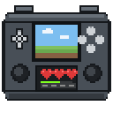

# AYN Thor Second Screen

**Minecraft's HUD, moved to the AYN Thor's bottom screen.**

This mod hides the game's HUD and streams what it was drawing — health, hunger,
armor, breath, XP, the hotbar and off-hand, the open inventory or container, and
chat — to a companion Android app on the same device, which draws it all on the
second display.

The top screen becomes all game. The bottom screen becomes the interface.

| | |
|---|---|
| **This repo** | the **Horizon** mod, written in Rust (`rust/`) |
| **Companion app** | [Android_AynThor_MinecraftSecondScreen](https://github.com/exojosh/Android_AynThor_MinecraftSecondScreen) |

You need **both**. They talk over a loopback socket (`127.0.0.1:48291`), and the
wire protocol is unchanged from the Fabric version, so the app is the same for
either.

## Horizon (current)

### Requirements

- **Horizon**, the Rust Minecraft client, on its `26.3` game build.
- The **`.hmod`** from [Releases](https://github.com/drivegoescrazy-glitch/AynThorSecondScreenRust/releases).
- The **companion APK** from the same release.

### Install

1. Add `aynthor_secondscreen-1.0.0.hmod` through the launcher's **Mods**
   page. To install by hand, copy it into the game folder's `horizon-mods/`
   (Linux: `~/.local/share/horizon/horizon-mods`) and add
   `mod.aynthor_secondscreen:true` to `horizon-mods.txt` beside `options.txt`.
2. Launch the game. A native mod is compiled by the launcher on first start;
   allow native code when it asks.
3. Start the companion app, then join a world. Either order works — the app
   reconnects on its own.

> **Build pin.** The package pins Horizon build `de8b4e25`, the last build whose
> SDK was public. If your launcher says the mod is for another build, re-pin it
> to the one you play with `cargo horizon-mod update` (see `rust/README.md`).

### What the second screen shows on Horizon

Health, absorption, armor, food, breath, XP, the hotbar and off-hand (tap a slot
to select it), the open inventory/container with tap-to-move, and chat — all the
same protocol messages the Fabric build sends.

Settings switches work the same way: turn an element off on the bottom screen
and the game draws it again on the top screen, so between the two displays the
HUD is drawn exactly once.

**Not yet on Horizon:** map tiles, item icons (the app's placeholder is shown),
vanilla textures from the game (the app's bundled set is used), the enchantment
glint flag, hardcore hearts, and a full key-binding list. `rust/README.md` has
the details. Everything else is the Fabric feature set.

## Fabric (previous version)

The Java mod is still in `src/` for reference and builds with JDK 21:

```
./gradlew build          # -> build/libs/aynthor_secondscreen_v1_21-1.0.0.jar
./gradlew runClient
```

It requires Minecraft 1.21.11, Fabric Loader 0.19.3+ and Fabric API. Its full
feature set is described in `thor-hud-handoff.md`.

## Troubleshooting

| What you see | What it is |
|---|---|
| App says **Not connected** | Horizon isn't running, or the mod didn't load. Check `horizon-mods.txt`. |
| **Port 48291 is taken** | Usually a leftover `adb reverse tcp:48291`. The mod retries every 5 s, and says so in your chat. |
| HUD drawn **twice** | An element was handed back to the game from Settings → *Show on this screen*. That is the feature. |
| Second screen never appears | No presentation-category display was found. Expected on phones; on the Thor, check the second screen in system settings. |

## License

[CC0-1.0](LICENSE) — public domain. Use it, fork it, ship it.

Minecraft textures are **not** redistributed by either half: the Fabric build
reads them from your own installation and hands them to the app over the socket,
and the Horizon build uses the app's bundled set.
